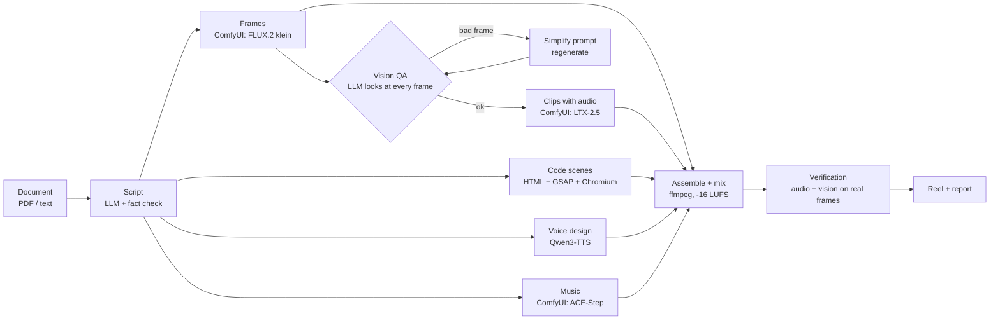

# Architecture

## Where Comfy comes in

Every generative visual/audio step is a **ComfyUI API-format workflow** stored in `leafreel/workflows/` and executed with the
**Comfy SDK** (`comfy_sdk.Comfy`) — see `leafreel/comfy.py`. `COMFY_BASE_URL` decides where the same code runs:

| Target | `COMFY_BASE_URL` |
|---|---|
| Self-hosted ComfyUI behind `comfy-api-proxy` (default) | `http://127.0.0.1:8189` |
| A Comfy API deployment | `https://<deployment>.run.comfy.app` |
| Comfy Cloud | unset |

Workflow parameters are addressed by name (`prompt`, `seed`, `reference`, `image`, …) and mapped to node inputs in `comfy.SPEC`;
a test checks every mapping against the workflow JSON.

## Two-machine layout used in development

* **App box** (ARM mini-PC, 121 GB unified memory): web app, LLM (script, fact-check, vision QA), ffmpeg, Chromium renders.
* **GPU box** (RTX 3090, 24 GB): ComfyUI + `comfy-api-proxy` + the Qwen3-TTS helper (`TTS_SSH`).

Everything also runs on a single machine with a 24 GB GPU; clips and frames are produced one job at a time on purpose.

## Style packs

A style is a JSON file in `leafreel/styles/` (or `$LEAFREEL_STYLES`): `engine` (`image`, `cinematic`, `motion`), the prompt style,
transition, camera, soundtrack tags and a voice description. Drop in a new file and it shows up in the UI and CLI.
