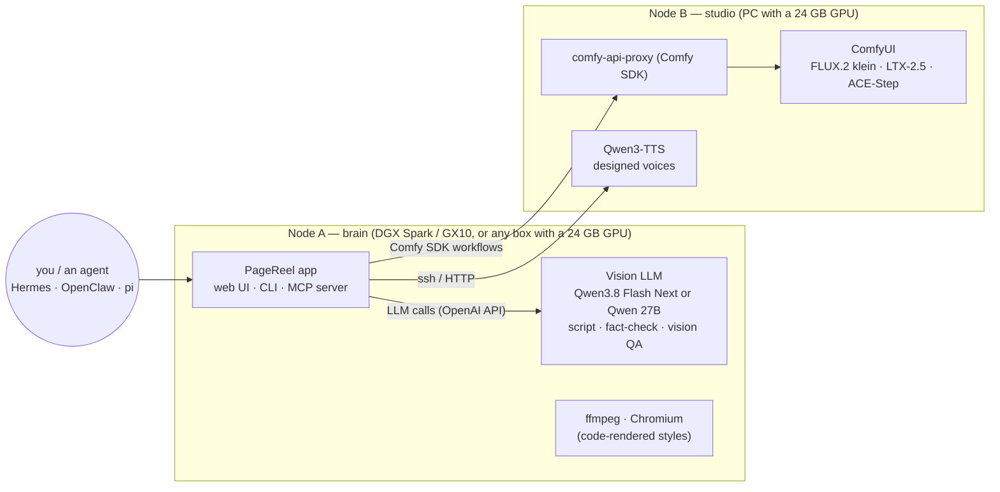

# The two-node recipe

PageReel is meant to be run as a **pair of machines**, each doing what it is best at. This is the setup everything in this repository was built and measured on.



## Why two nodes

| | Node A: brain | Node B: studio |
|---|---|---|
| Job | Reads your document, writes and fact-checks the script, *looks at every frame*, stitches the video | Draws frames, makes video clips with sound, composes music, speaks |
| Needs | A vision LLM resident in memory all the time (a 27–35B-class model fills a 24 GB card or a DGX Spark) | A 24 GB GPU free for diffusion models that load and unload per step |
| Tested on | NVIDIA GX10 (GB10, 121 GB unified memory) serving Qwen3.8 Flash Next (FP4, ~82 GiB, ~35 tok/s, 262k context) | PC with an RTX 3090 (24 GB), 62 GB RAM |

Keeping the LLM and the diffusion models on **different devices** is what makes the pipeline smooth: nothing is swapped in and out of VRAM between "write the script" and "draw the frame", and the vision QA can inspect frame *n* while the studio draws frame *n+1*.
You can run it on one machine with enough memory, but the recipe (and the measured numbers) are for two.

## Bring-up in six steps

1. **Network.** Put both nodes on a private network (LAN or Tailscale). Nothing here should face the internet.
2. **Node B — ComfyUI + models.** Install ComfyUI with ComfyUI-GGUF and the model files from [SETUP.md](SETUP.md).
3. **Node B — Comfy SDK proxy.** `pip install comfy-api-proxy`, then install `deploy/systemd/comfy-api-proxy.service` (it binds to the private interface and requires a bearer token).
4. **Node B — narration.** `pip install qwen-tts soundfile` in a venv; PageReel runs the helper over ssh (`TTS_SSH`).
5. **Node A — LLM + app.** Serve any OpenAI-compatible vision model; `pip install -e '.[agents]'`; `scripts/setup_motion.sh`; copy `deploy/pagereel.env.example` to `~/.config/pagereel.env`.
6. **Check everything:**

```bash
set -a; . ~/.config/pagereel.env; set +a
pagereel doctor            # LLM + vision, proxy, model files, narration, Chromium  ->  "Styles ready"
python scripts/check_open_weights.py   # proves the workflows contain no partner/API nodes
pagereel serve
```

`pagereel doctor` ends with the list of styles that are ready on *your* hardware, so you know what to expect before the first run.

## Operating notes (learned the hard way)

* **One GPU job at a time.** A long LTX run kept an RTX 3090 at 100 % for half an hour; the card was thermally limited and once fell off the bus under sustained load. PageReel serializes jobs and has `GPU_COOLDOWN=<seconds>` to pause between clips. With 40 s pauses, a 35-minute cinematic reel ran clean.
* **Watch temperatures, not just utilization.** `nvidia-smi -q -d PERFORMANCE` shows *SW/HW Thermal Slowdown*; memory/hot-spot temperature is not exposed on every board.
* **Remote login shells vary** (bash, fish, zsh). PageReel hands remote commands to `bash -c`, so they survive.
* **Agents doing maintenance.** If an agent needs occasional root on a node (restart ComfyUI, change the GPU power limit), prefer *scoped, expiring* sudo grants over a permanent NOPASSWD rule. [`nopasswd-sudo`](https://github.com/sudoingX/nopasswd-sudo) (Apache-2.0) does exactly that: `sudo nopasswd-sudo on 1 --allow systemctl,nvidia-smi`. It is single-machine and optional, and not a dependency of PageReel.

## Driving it from an agent

See [AGENT_INTEGRATION.md](AGENT_INTEGRATION.md): the same recipe, controlled by Hermes Agent (or any MCP client) from a chat app.
